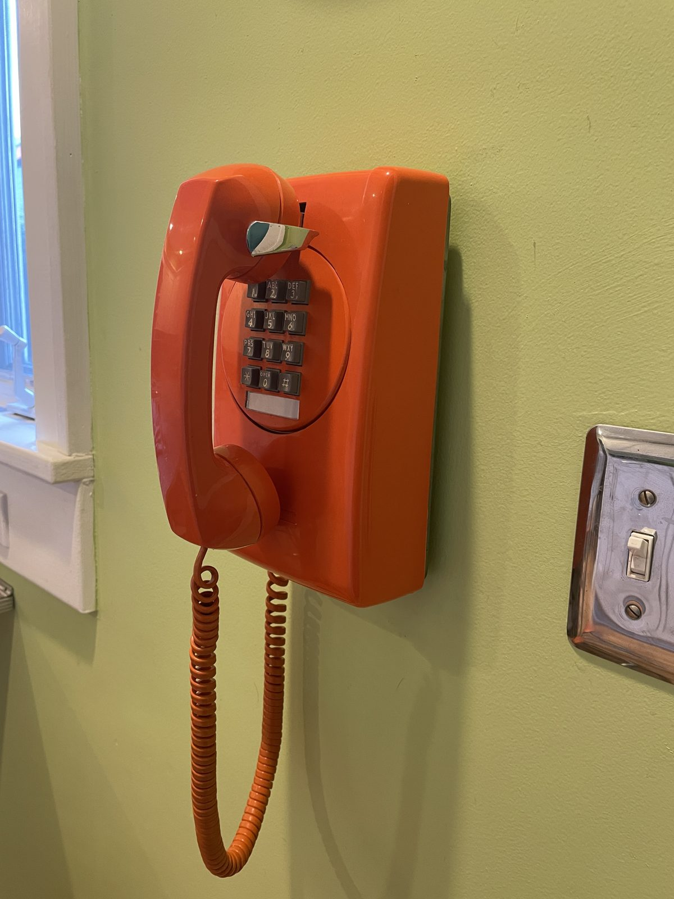
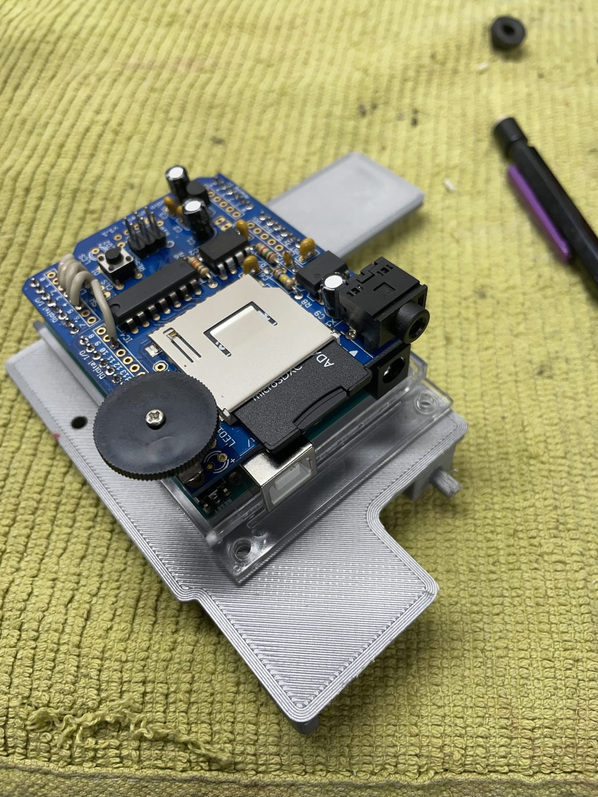
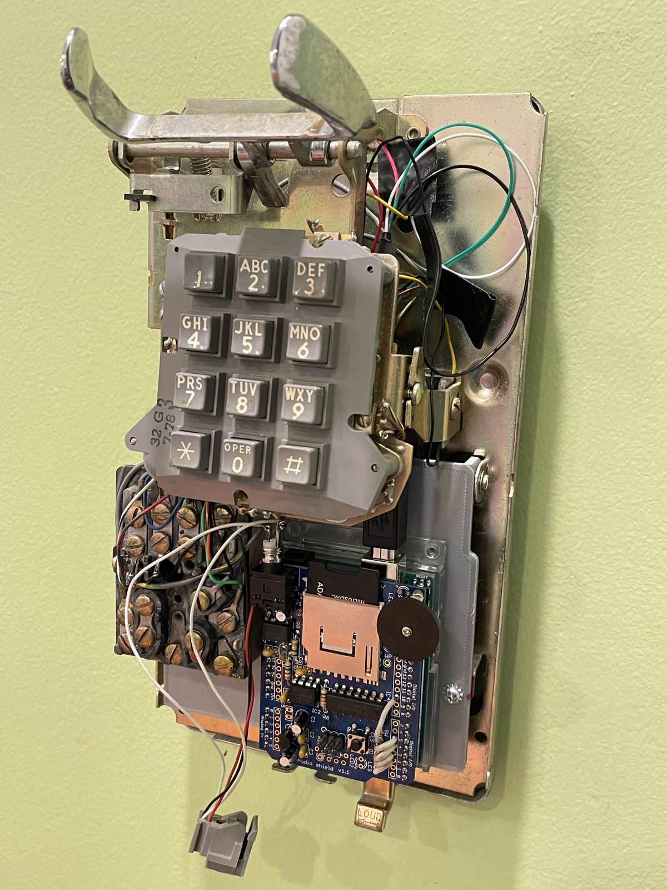

# Orange Phone

An old orange wall phone that plays my kids' childhood voicemails when you pick up the handset.



## Background

When my kids were young, they'd leave messages on my work answering machine. Usually they wanted to know what I was doing at work, or what they wanted to do when I got home. When the corporate voicemail system was phased out, I downloaded the messages that had been saved over the years.

At first I just kept them on my laptop so they could be heard as the kids grew older. Then I had a better idea: put them back in a phone.

## How it works

I took an old land-line phone, removed some of the internals, and put in an Arduino with an audio shield.

1. **Lifting the handset** closes a reed switch on the hook lever. That switch carries the Arduino's power, so the Arduino starts up.
2. **On startup**, the sketch reads the SD card and **shuffles the list of messages** into a random order. It's seeded from an unconnected analog pin, so the order is different each time.
3. **Then it plays the messages one after another** through the handset earpiece. After the last one, it starts over in the same order.
4. **Hanging up** cuts the power. The next pickup reboots the Arduino and gets a new shuffle.

## Hardware

- **Arduino Uno** (ATmega328-based. The Wave Shield won't work with a Mega, Leonardo, Due or Zero.)
- **[Adafruit Wave Shield v1.1](https://learn.adafruit.com/adafruit-wave-shield-audio-shield-for-arduino)**. It came as a kit, so every component had to be soldered onto the board. It plays WAV files from an SD card.
- **Vintage orange wall phone** with a push-button keypad
- **3D-printed mounting bracket** to hold the Arduino inside the phone's chassis. The STL file is in [`hardware/ArduinoPhoneMount.stl`](hardware/ArduinoPhoneMount.stl). It's about 115 × 106 × 13 mm.
- **Arduino power supply**, wired to the line coming into the phone
- **SD card** with the voicemail WAV files

### Wiring changes to the phone

- The Wave Shield's audio output is wired to the handset earpiece through the phone's existing terminal block.
- **Power comes from a cut USB cable.** A USB cable was cut open and spliced into the wires coming into the phone. That way, a USB power adapter outside the phone powers the Arduino through its normal USB port.
  - Only the **+5V** (USB pin 1) and **ground** (USB pin 4) wires are used. They're usually red and black, but check with a multimeter, since colors vary. The two data wires, usually green and white, aren't connected.
  - The +5V line runs through one of the **reed switches on the handset hook lever**, so lifting the handset turns the Arduino on and hanging up turns it off.

The [build log](docs/build-log.md) has photos of every stage, including close-ups of the terminal block wiring.

| Wave Shield on the bracket | Installed in the phone |
|---|---|
|  |  |

## Firmware

The sketch is [`firmware/sketch_OrangePhone/sketch_OrangePhone.ino`](firmware/sketch_OrangePhone/sketch_OrangePhone.ino).

### Library

It uses **WaveHC 1.0.3**, Adafruit's library for the Wave Shield. It's available from the Arduino Library Manager or [GitHub](https://github.com/adafruit/WaveHC).

The library isn't included in this repo. One setting in it was changed from the default. In `WaveHC.h`:

```c
#define DVOLUME 1   // default is 0
```

This turns on the library's software volume control. The sketch never changes the volume, so playback sounds the same either way. The change was probably left over from trying the `SoftVolumeHC` example. Set it to match if you want an exact copy of the original setup.

### Changing the messages

The playlist is hard-coded at the top of the sketch. To add or remove a message, update all three of these:

- `VCnames[]`: the filenames
- `VClistLength`: the number of files
- `VCplayorder[]`: one entry per file, numbered `0, 1, 2, …`

The serial monitor (9600 baud) prints the shuffled order and each file as it plays, which helps with debugging over USB.

## Preparing the audio files

The Wave Shield is picky about formats:

- **WAV, uncompressed PCM, mono, 22 kHz or less.** Audacity can convert to this format: set the track to mono, set the project rate to 22050 Hz, then export as "WAV (Microsoft) signed 16-bit PCM".
- **SD card formatted as FAT16 or FAT32.** The WaveHC library supports both. Put files in the root folder with 8.3 names, such as `KPOOL.WAV`.

The voicemail recordings themselves aren't in this repo. `.gitignore` excludes `.wav` files.

## Repository layout

```
orange-phone/
├── README.md
├── firmware/
│   └── sketch_OrangePhone/
│       └── sketch_OrangePhone.ino   Arduino sketch
├── hardware/
│   └── ArduinoPhoneMount.stl        3D-printed bracket
└── docs/
    ├── build-log.md                 photo build log
    └── images/                      photos
```

## Timeline

- **December 2021:** built and installed
- **March 2022:** cover back on

## Credits

- **Adafruit Wave Shield tutorial:** build instructions, schematics and example code for the shield.
  https://learn.adafruit.com/adafruit-wave-shield-audio-shield-for-arduino
- **WaveHC library** by William Greiman and Adafruit, used for WAV playback and SD card access.
  https://github.com/adafruit/WaveHC
